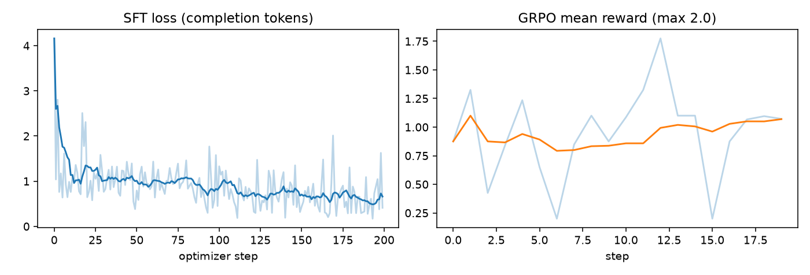
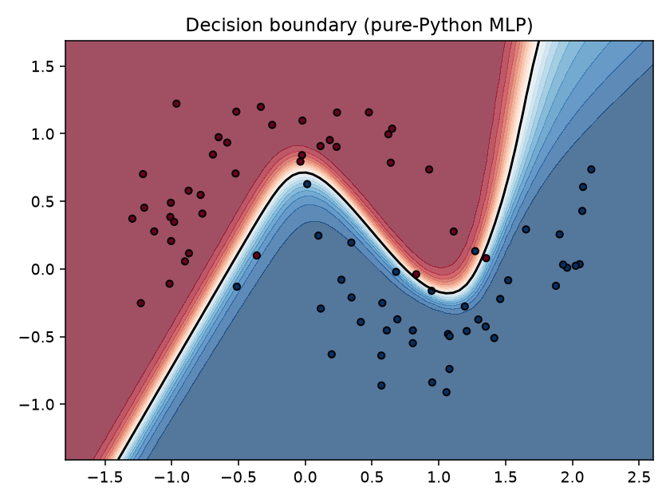

# LogicalLLM - Fine-tuning LLMs for Game AI (Poker & Chess)

*Seasons of Code, Web and Coding Club, IIT Bombay (May-Jul 2025), later extended into an end-to-end project.*

Can a small language model learn to play imperfect-information (poker) and perfect-information (chess) games, and how
do you measure that honestly against solvers and engines? This repo builds the full stack, from a neural net written
in pure Python up to LoRA instruction-tuning, GRPO reinforcement learning, engine integration and an evaluation framework.

| | |
|---|---|
| **Poker** | LoRA instruction-tuning, then **GRPO** with a verifiable, solver-derived reward, on [PokerBench](https://huggingface.co/datasets/RZ412/PokerBench) |
| **Chess** | LoRA instruction-tuning on real Lichess games; **LLM + Stockfish** hybrid agent; legal-move / centipawn-loss / match evaluation |
| **From scratch** | MLP with manual backprop (pure Python, no NumPy); GPT-2 byte-level BPE tokenizer and full transformer forward pass (NumPy) |
| **Demo** | Gradio app: compare base vs fine-tuned poker decisions, play chess against the model, generate text with the NumPy GPT-2 |

## Results

All models: **Qwen2.5-0.5B-Instruct + LoRA**, trained on an NVIDIA laptop GPU (`--profile gpu`; a smaller 8 GB-MacBook run is in `results_mac/`).
Poker is evaluated on a fixed, class-balanced **500-hand subset of the PokerBench test split** (chance = 20%).


| Poker policy | Action-type accuracy | Mean reward (max 2.0) |
|---|---|---|
| Chance / always-call | 20% | 0.56 |
| Zero-shot (base model; almost always answers "fold") | 21% | 0.54 |
| + LoRA SFT (8,000 hands, 500 steps) | **53.6%** | 1.16 |
| + GRPO (200 steps from the SFT adapter) | **54.0%** | 1.16 |

Per-action accuracy (the interesting part):

| | fold | check | call | bet | raise |
|---|---|---|---|---|---|
| SFT | 60% | 78% | 61% | 26% | 43% |
| SFT + GRPO | 32% | 48% | 69% | **62%** | **59%** |



**Takeaways, honestly stated**
- Instruction tuning is what does the heavy lifting: 21% to 54% (2.5x chance) with 8,000 hands. SFT loss fell from about 0.96 to 0.32.
- **GRPO did not improve overall accuracy** (54.0% vs 53.6% and equal mean reward, both within noise at n=500, about 2 points standard error), and the GRPO training reward is noisy and roughly flat (about 1.0 to 1.1 over 200 steps).
- GRPO **did change behaviour**: the policy moved away from passive actions toward betting and raising (bet 26% to 62%, raise 43% to 59%) at the cost of fold/check accuracy. That's the size-aware reward doing what it was designed to do, but at this budget it redistributes accuracy instead of adding any.
- Likely reasons and next steps: group size of only 4, 200 steps, KL penalty off (beta=0), a 0.5B model. Next experiments: larger group (8-16), more steps, a bigger model (the Colab notebook uses Gemma-3-1B).


| Chess agent (100 held-out Lichess positions) | Legal first move | Avg. centipawn loss (lower = better) | Games vs 1350-Elo Stockfish |
|---|---|---|---|
| Random legal move | 100% | 445 | - |
| LLM only (SFT on ~12k positions from 3,000 games) | 24% | 405 | 0 / 10 |
| LLM proposes, Stockfish verifies (k=5) | - | 259 | 1 / 10 |

- **Read the hybrid number carefully:** when none of the LLM's candidates is legal, the hybrid falls back to Stockfish, so most of its improvement is Stockfish doing the work, not the LLM.
- Training on 7.5x more data than my first run (400 games) moved the legal-move rate only from 22.5% to 24%. So **data volume is not the bottleneck**: a 0.5B model does not learn to read a board from a FEN string alone. It learned the move *format*, not chess. The evaluation framework is the reusable part.
- Next steps: put the list of legal moves in the prompt, use a larger model, or supervise on engine-labelled best moves instead of human moves.

## Quick start

```bash
git clone https://github.com/nishilseth/LogicalLLM.git && cd LogicalLLM
python -m venv .venv && source .venv/bin/activate        # Windows: .venv\Scripts\activate
pip install torch                                         # NVIDIA GPU: use the CUDA build, see docs/TRAINING.md
pip install -r requirements.txt
python scripts/setup_stockfish.py                         # chess engine
python -m pytest -q tests                                 # 15 tests

python demo/app.py                                        # interactive demo (needs trained adapters in outputs/)
python scripts/train_all.py --profile mac                 # or --profile gpu; full pipeline, resumable
```
Full instructions for training on an NVIDIA laptop: [docs/TRAINING.md](docs/TRAINING.md). Colab/Unsloth GRPO notebook (Gemma-3-1B): [notebooks/poker_grpo_colab.ipynb](notebooks/poker_grpo_colab.ipynb) - *written but not yet executed*.

## How it works

### Poker: SFT then GRPO ([logicalllm/poker](logicalllm/poker))
PokerBench labels come from a game-theory-optimal solver, so every prompt has a *checkable* answer - ideal for RL with verifiable rewards.
1. **SFT** teaches the output format and a first-order policy (loss on completion tokens only).
2. **GRPO** samples a *group* of G actions per hand, scores each with the reward below, and uses the **z-score of the reward within the group** as the advantage, `A_i = (r_i - mean) / std`, with no value network. PPO-style clipped updates (TRL's `GRPOTrainer`).
3. **Reward** ([reward.py](logicalllm/poker/reward.py), max 2.0): 0.2 for a well-formed single action, 1.0 for the right action type, up to 0.8 for bet/raise size closeness. Partial credit on size provides a learnable signal where exact chip counts are noise.

### Chess ([logicalllm/chess](logicalllm/chess))
- **Data:** streams the Lichess open database; keeps games with both players >= 1800 Elo and learns from the *winner's* moves. Prompt = FEN + recent moves; target = SAN move.
- **Engine integration:** [`engine.py`](logicalllm/chess/engine.py) wraps Stockfish; [`agent.py`](logicalllm/chess/agent.py) has an LLM-only agent and a hybrid that has the LLM propose k candidates (beam search) and Stockfish pick the best legal one.
- **Evaluation framework:** [`evaluate.py`](logicalllm/chess/evaluate.py) reports legal-move rate, top-1 agreement with Stockfish, average centipawn loss, and match play against Elo-limited Stockfish.

### From scratch ([foundations/](foundations))
- **MLP** ([mlp_from_scratch](foundations/mlp_from_scratch)): pure Python, manual backprop, mini-batch SGD, binary cross-entropy; 96% test accuracy on two-moons. Backprop is verified against numerical gradients in the tests.
  
- **Transformer** ([transformer_from_scratch](foundations/transformer_from_scratch)): GPT-2 byte-level BPE tokenizer written from scratch (matches `tiktoken` exactly on the test strings), multi-head **causal** self-attention, GELU MLP, LayerNorm, tied output embeddings, generating coherent text from the real GPT-2 weights in pure NumPy. A test proves that perturbing a future token cannot change earlier positions.
  `python foundations/transformer_from_scratch/main.py "Poker is a game of"`

### Paper notes ([docs/paper-notes.md](docs/paper-notes.md))
Written analysis of QLoRA, PokerGPT and GRPO/DeepSeekMath, including limitations and proposed extensions.

## Repo layout
```
foundations/    MLP (pure Python) and GPT-2 forward pass (NumPy)
logicalllm/     poker/ chess/ common/   - data, rewards, training, evaluation
scripts/        train_all.py  check_env.py  setup_stockfish.py  make_figures.py
demo/app.py     Gradio demo          notebooks/  Colab GRPO notebook
tests/          15 unit tests        docs/       notes, figures, training + demo guides
results/        metrics (JSON) behind every number above
```

## Limitations
- Small models (0.5B) and modest data, constrained by laptop hardware. The results show a working, evaluated pipeline, not state-of-the-art play.
- GRPO gave no net accuracy gain over SFT in this run; the Colab/Gemma-3-1B notebook has not been executed.
- Poker is scored on action type (plus size credit) against solver labels, not on game-theoretic exploitability or win-rate in actual play.
- Chess evaluation is 100 positions and 10 games: enough to see the gap, too small for tight confidence intervals. The LLM-only agent never won a game.
- Single seed per experiment; differences of about 2 points on poker accuracy are within noise.
